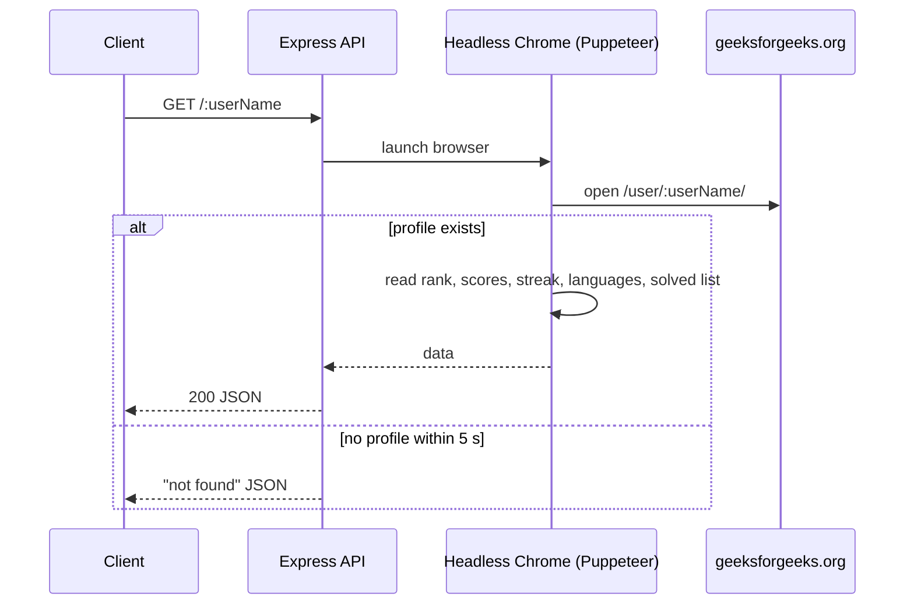

<div align="center">

# 🟢 GFG Public API

**An unofficial REST API that returns any GeeksforGeeks user's profile stats as clean JSON — rank, coding score, problems solved, streak and the full solved-problems list.**

[](https://gfg-api-tzvp.onrender.com/)


[Try it](#-try-it-now) · [Response](#-response-format) · [How it works](#%EF%B8%8F-how-it-works) · [Run locally](#%EF%B8%8F-run-locally) · [Use cases](#-use-cases)

</div>

---

## ⚡ Try it now

Replace `<username>` with any GeeksforGeeks handle:

```bash
curl https://gfg-api-tzvp.onrender.com/<username>
```

> ⏳ Hosted on Render's free tier — the first request after a while may take ~30 s while the service wakes up.

## 📦 Response format

<details open>
<summary><b>✅ <code>200</code> — user found</b></summary>

```json
{
  "API_auther": "Shariq https://www.linkedin.com/in/shariq-sd/",
  "name": "username",
  "rank": "Institute rank",
  "institute": "Your College",
  "overall_coding_score": "1234",
  "total_problems_solved": "456",
  "monthly_coding_score": "78",
  "current_streak": "12",
  "languages": "C++, Java, Python",
  "All_solved_problems": ["Two Sum", "Kadane's Algorithm", "..."]
}
```

</details>

<details>
<summary><b>❌ User not found</b></summary>

```json
{
  "Status": "User <username> not found",
  "Shariq ": "You have entered wrong username, try again. Thank you!"
}
```

</details>

### Endpoints

| Method | Endpoint | Description |
|---|---|---|
| `GET` | `/` | Health message |
| `GET` | `/:userName` | Profile stats for the given GFG user |

## ⚙️ How it works



## 🛠️ Run locally

### Prerequisites

- Node.js **14.20.1+** and npm

```bash
git clone https://github.com/Shariq2003/GFG-API.git
cd GFG-API
npm install          # also downloads Chrome for Puppeteer (postinstall)
npm start            # or: npm run dev (nodemon)
```

Then open **http://localhost:3000/&lt;username&gt;**.

<details>
<summary><b>🧩 Troubleshooting</b></summary>

- **Chrome not found** → run `npx puppeteer browsers install chrome`.
- **Empty / wrong fields** → GeeksforGeeks occasionally changes its CSS class names; update the selectors in [`userData.js`](userData.js).
- **Running in Docker / Linux servers** → the browser is already launched with `--no-sandbox --disable-setuid-sandbox`.

</details>

## 💡 Use cases

- Show live GFG stats on your **portfolio** or **GitHub profile README**
- Build **leaderboards** for a college coding club
- Track your own **daily streak** and progress over time

---

<div align="center">

Built by **[Shariq](https://github.com/Shariq2003)** · [LinkedIn](https://www.linkedin.com/in/shariq-sd)

⭐ If this API helped you, consider giving it a star!

</div>
